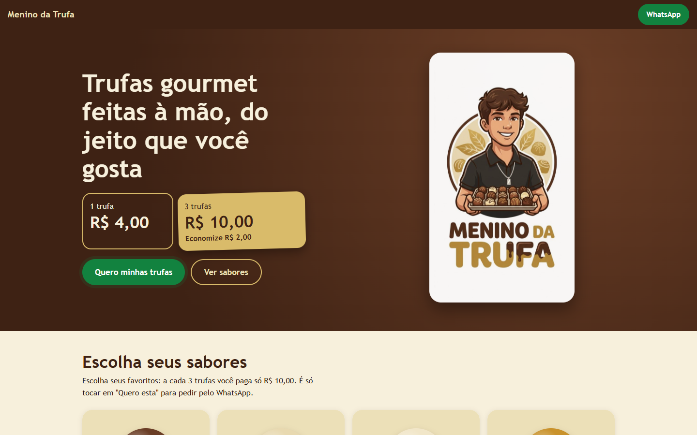

<div align="center">
  <h1>Menino da Trufa</h1>
  <p><strong>Catálogo responsivo e fluxo de pedido por WhatsApp em uma única página.</strong></p>
  <p>
    <a href="https://neisanta.github.io/trufa/"><strong>▶ Ver demonstração</strong></a>
    ·
    <a href="#funcionalidades"><strong>Funcionalidades</strong></a>
    ·
    <a href="#como-executar"><strong>Executar localmente</strong></a>
  </p>
</div>

---

Menino da Trufa é uma página estática para apresentar uma vitrine de trufas gourmet, calcular a promoção e encaminhar o cliente para o WhatsApp. Toda a interface está em um único arquivo HTML, com CSS e JavaScript embutidos e sem dependências de instalação.

<div align="center">
  
</div>

## Funcionalidades verificadas no código

- vitrine responsiva de sabores com descrição, preço e imagem opcional;
- promoção configurável para quantidade e preço do combo;
- cálculo automático da economia da promoção;
- link de pedido por WhatsApp com o sabor selecionado;
- exibição do telefone e cópia da chave PIX;
- painel demonstrativo para criar, editar, ocultar e remover itens;
- upload de foto reduzido no navegador para JPEG;
- persistência do catálogo em `localStorage`;
- restauração do catálogo padrão;
- confirmação em dois toques para ações destrutivas;
- suporte a `prefers-reduced-motion` e foco visível.

## Tecnologias utilizadas

| Tecnologia | Função no projeto |
|---|---|
| **HTML5** | estrutura semântica da vitrine, pedido e painel |
| **CSS3** | layout responsivo, paleta, cards, modal e animações |
| **JavaScript** | catálogo, cálculo da promoção, links de pedido e persistência |
| **LocalStorage** | guarda as alterações do catálogo no navegador |
| **Canvas / FileReader** | redução e validação de imagens antes de persistir |
| **Git / GitHub Pages** | versionamento e publicação da demonstração |

## Arquitetura e organização

```text
index.html   Interface, estilos, lógica e configuração da aplicação
docs/        Captura real usada na documentação
```

A aplicação não possui backend nem banco de dados. O catálogo inicial e os dados de contato ficam no objeto `CONFIG`, no início do script. As alterações feitas no painel são salvas apenas no navegador que realizou a edição.

## Dados e persistência

- o catálogo inicial é definido no código;
- o painel grava a versão editada em `localStorage`, sob a chave `mdt_produtos_v1`;
- a versão local pode ser restaurada pelo painel;
- não existe sincronização entre navegadores, dispositivos ou usuários;
- a chave PIX e o telefone são somente dados de apresentação do negócio.

## Como executar

### Visualização direta

Abra [`index.html`](index.html) no navegador. A maior parte dos recursos funciona sem servidor.

### Servidor local opcional

Com PHP:

```bash
php -S localhost:8000
```

Acesse <http://localhost:8000/>.

A demonstração pública está disponível pelo GitHub Pages em <https://neisanta.github.io/trufa/>.

## Segurança e limitações

O painel administrativo é **demonstrativo**. A comparação de usuário e senha ocorre no JavaScript do navegador, portanto qualquer visitante pode contorná-la. A credencial presente no código deve ser vista apenas como um placeholder local e não como proteção real.

Antes de usar o painel com dados reais, é necessário:

- mover a credencial para uma configuração revisada e nunca reutilizar uma senha pessoal;
- substituir a autenticação no cliente por autenticação no backend;
- persistir o catálogo em uma API ou banco de dados com controle de acesso;
- revisar os dados de contato e de pagamento antes de cada publicação;
- não armazenar informações sensíveis em `localStorage`.

## Aprendizados demonstrados

- construção de uma interface comercial responsiva sem framework;
- manipulação segura do DOM e atualização dinâmica de uma vitrine;
- cálculo de regras simples de preço e promoção;
- integração de ações do usuário com WhatsApp;
- redução de imagem no cliente e uso de armazenamento local;
- aplicação de feedback visual, confirmação e acessibilidade básica.

## Próximas melhorias

- separar conteúdo, estilo, lógica e configuração em arquivos próprios;
- implementar autenticação e persistência no backend;
- validar e sanitizar toda entrada antes de salvar;
- adicionar testes automatizados para preço, promoção e geração do link de pedido;
- melhorar SEO, metadados sociais e carregamento da imagem principal;
- definir uma política de conteúdo para dependências externas e cache.

---

<div align="center">
  <sub>Projeto frontend de demonstração com foco em interface responsiva e fluxo de pedido simples.</sub>
</div>
